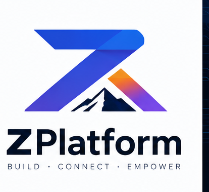

# ZPlatform

<p align="center">
  
</p>

<p align="center">
  <strong>BUILD · CONNECT · EMPOWER</strong><br/>
  <em>Embedded for a Brighter Tomorrow</em> · <em>Small Steps. Real Impact.</em>
</p>

ZPlatform is a scalable, modular platform layer for **Zephyr RTOS**. It hosts
STM32 evaluation kits, custom boards, out-of-tree drivers, middleware, and
platform services without restructuring the repository.

Brand kit (colors, slogans, icons, banners):
[`docs/brand/README.md`](docs/brand/README.md).

## Zephyr version

| Item | Value |
|------|-------|
| Source of truth | [`config/toolchain.yml`](config/toolchain.yml) |
| Release line | **4.4** |
| Exact version | **4.4.2** |
| Git revision | **v4.4.2** |
| SDK | **≥ 1.0.0** |
| Python | **≥ 3.12** |

Do not edit `west.yml` revision independently — sync via
[`scripts/README.md`](scripts/README.md) (`setup-zephyr` `--sync-manifest`).

## First hardware target

| Item | Value |
|------|-------|
| Board | STM3210E-EVAL |
| MCU | STM32F103ZGT6 (Cortex-M3) |
| Flash / SRAM | 1024 KiB / 96 KiB |
| Upstream board | **Not present** — ZPlatform provides OOT support |

## Quick start

```powershell
.\scripts\ps1\build.ps1 demo -Board stm3210e_eval
```

```bash
./scripts/sh/build.sh demo --board stm3210e_eval
```

```bat
scripts\cmd\build.cmd demo --board stm3210e_eval
```

Build bootstraps `.venv`, west workspace, Zephyr **v4.4.2**, and a compatible
SDK. **All scripts, flags, and shell combinations:**
[`scripts/README.md`](scripts/README.md). Environment details:
[`docs/environment.md`](docs/environment.md).

## STM3210E-EVAL

Default board `stm3210e_eval`. Outputs:
`build/stm3210e_eval/{demo,sample,boot}/.../<config>/`.

| Config | Linker / flash |
|--------|----------------|
| `default` / `debug` / `release` / `profile` | Single DTS `code_partition` = whole 1 MiB @ `0x08000000` |
| `mcuboot` | Slot0 link + signed `zephyr.signed.bin` |

Every build has one `zephyr,code-partition` (marked `<- THIS IMAGE` in the
post-build layout print). Standalone and MCUboot maps are different DTS views.

| File | Role |
|------|------|
| [`boards/st/stm3210e_eval/stm3210e_eval.dts`](boards/st/stm3210e_eval/stm3210e_eval.dts) | Standalone `code_partition` |
| [`boards/st/stm3210e_eval/support/partitions_mcuboot.dtsi`](boards/st/stm3210e_eval/support/partitions_mcuboot.dtsi) | MCUboot: boot / slot0 / slot1 / storage |
| [`boards/st/stm3210e_eval/stm3210e_eval_mcuboot.overlay`](boards/st/stm3210e_eval/stm3210e_eval_mcuboot.overlay) | App → `&slot0_partition` |
| [`boards/st/stm3210e_eval/support/mcuboot.overlay`](boards/st/stm3210e_eval/support/mcuboot.overlay) | Bootloader → `&boot_partition` |
| [`boards/st/stm3210e_eval/support/mcuboot.conf`](boards/st/stm3210e_eval/support/mcuboot.conf) | MCUboot Kconfig |

Hardware connection, bring-up, and board notes:
[`docs/boards/stm3210e_eval.md`](docs/boards/stm3210e_eval.md).
Keys: [`keys/README.md`](keys/README.md).

## Repository layout

```text
zplatform/
├── config/toolchain.yml       # environment lock (authoritative)
├── boards/st/stm3210e_eval/   # OOT board support
├── demo/<board>/              # per-board full showcase
├── samples/                   # shared samples (DT / Kconfig gated)
├── lib/                       # platform services
├── drivers/                   # out-of-tree Zephyr drivers
├── dts/bindings/              # ZPlatform DeviceTree bindings
├── include/zplatform/         # public headers (incl. brand.h)
├── tests/                     # Ztest / Twister
├── scripts/                   # sh/ + ps1/ + cmd/ + env/  → scripts/README.md
├── docs/                      # architecture, board, environment, test, debug, brand
├── build/<board>/...          # isolated demo|sample|boot / <config> outputs
├── keys/                      # signing key docs (no private keys)
├── west.yml                   # west manifest (revision synced from toolchain.yml)
└── zephyr/module.yml          # Zephyr module metadata
```

## Documentation

- [Brand](docs/brand/README.md) — logo, colors, slogans, asset catalog
- [Scripts](scripts/README.md) — setup, build, clean, flash, debug, demo, MCUboot, test
- [Environment manager](docs/environment.md)
- [Architecture](docs/architecture/platform.md)
- [STM3210E-EVAL](docs/boards/stm3210e_eval.md)
- [Debugging](docs/debugging/README.md)
- [Testing](docs/testing/README.md)

## License

Apache License 2.0 — see [LICENSE](LICENSE).
