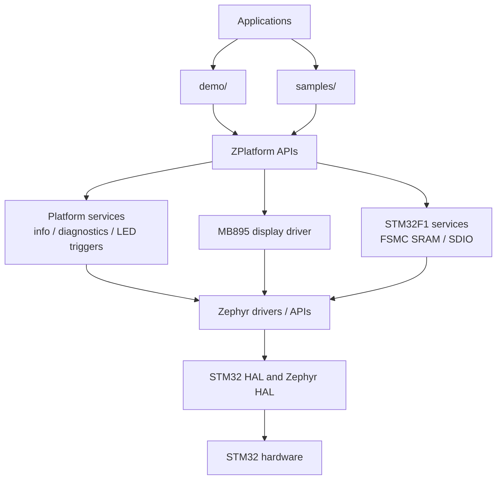
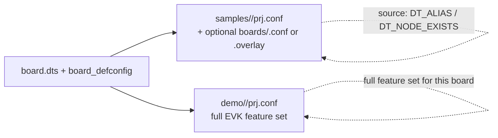

# ZPlatform Architecture

ZPlatform is a Zephyr **module** (and west manifest project) that provides:

- out-of-tree board support
- reusable platform libraries
- shared, DeviceTree-gated peripheral samples
- **one full demo application per board**
- developer scripts for build / flash / debug / profile / test
- MCUboot integration for selected boards

## Layering



Applications can use Zephyr APIs directly; only applications that need a
ZPlatform service include its public API. The samples are not all layered
through ZPlatform. For example, the sensor and SPI flash samples use Zephyr
drivers, while the LCD, external SRAM, and microSD samples use ZPlatform
components.

## Ownership

| Area | Owner |
|------|-------|
| Kernel, upstream drivers, HAL, networking, FS, USB, BT | Zephyr |
| Out-of-tree boards, drivers, platform services, demos, scripts | ZPlatform |

Do not fork Zephyr. Do not vendor the Zephyr tree inside this repository.

### Board vs sample vs demo

| Layer | Owns | Does not own |
|-------|------|----------------|
| Board (`boards/<vendor>/<board>/`) | Pins, clocks, partitions, aliases, minimal bring-up Kconfig | App feature lists (SHELL, sensors-for-demo, …) |
| Sample (`samples/<name>/`) | One peripheral story; usually DeviceTree-gated source | Board policy and unnecessary hard-coded pins |
| Demo (`demo/<board>/`) | Full showcase for that hardware | Other boards’ peripherals |



**Rule:** DeviceTree describes peripheral presence and wiring; Kconfig enables
software. Prefer `DT_ALIAS` / `DT_NODE_EXISTS` / `DEVICE_DT_GET_OR_NULL` for
shared feature selection rather than board-name checks. There are intentional
board-specific cases: `samples/gpio` selects its STM3210E-EVAL control path
using `CONFIG_BOARD_STM3210E_EVAL` (`samples/gpio/CMakeLists.txt` and
`samples/gpio/src/main.c`), and the per-board demo contains EVK-specific UI
code.

### Platform services and interfaces

The public C interfaces are under `include/zplatform/`; their implementations
are conditionally added by the root `CMakeLists.txt` according to `Kconfig`:

| Interface | Responsibility | Configuration |
|-----------|----------------|---------------|
| `zplatform/info.h` | Board/build identity, UID, reset cause, and startup banner | `CONFIG_ZPLATFORM_LIB_COMMON` |
| `zplatform/diag.h` | Linker-based memory estimates and current thread count | `CONFIG_ZPLATFORM_LIB_DIAGNOSTICS` |
| `zplatform/profile.h` | Cycle counter access and elapsed-cycle helper | `CONFIG_ZPLATFORM_PROFILING` (off by default) |
| `zplatform/led_triggers.h` | Software LED patterns, pause/rotate controls, panic LED | `CONFIG_ZPLATFORM_LED_TRIGGERS` |
| `zplatform/mb895_lcd.h` | MB895 controller and drawing helpers used by the Zephyr display driver | `CONFIG_ZPLATFORM_MB895_LCD` |
| `zplatform/fsmc_sram.h` | STM32F1 FSMC bank 3 initialization and SRAM self-test | `CONFIG_ZPLATFORM_FSMC_SRAM` |
| `zplatform/sdio_sd.h` | STM32F1 SDIO card detection and polling block I/O | `CONFIG_ZPLATFORM_SDIO_SD` |

`CONFIG_ZPLATFORM_SHELL` registers `zplatform info`, `zplatform board`, and
`zplatform memory` when Zephyr shell support is enabled. Memory usage is an
estimate derived from linker symbols and DeviceTree totals; it is not a
runtime heap-usage measurement. The LCD component registers a Zephyr
`display` device; it supports RGB565 and reports the dimensions from its
DeviceTree binding (`dts/bindings/display/zplatform,mb895-lcd.yaml`).

### Conf / DTS merge order

**Samples**

1. Board `*_defconfig`
2. Sample `prj.conf`
3. Optional `samples/<name>/boards/<board>.conf` (Zephyr auto-merge)
4. Optional `samples/<name>/boards/<board>.overlay` (rare: enable a disabled node)

**Demos**

1. Board `*_defconfig`
2. `demo/<board>/prj.conf`
3. `demo/<board>/prj_mcuboot.conf` (or script `-DCONFIG_*`) when `-Mcuboot`
4. Board-package overlays for policy (e.g. MCUboot code partition)

Board `*_defconfig` stays **minimal** (clock, GPIO, console UART, pinctrl,
hwinfo). Demo/sample features live in the app `prj.conf`.

### Build selection

```text
./scripts/ps1/build.ps1 demo -Board stm3210e_eval
  → sources demo/stm3210e_eval/
  → build/stm3210e_eval/demo/default/

./scripts/ps1/build.ps1 sample gpio -Board stm3210e_eval
  → sources samples/gpio/
  → build/stm3210e_eval/sample/gpio/default/

./scripts/ps1/build.ps1 demo -Board stm3210e_eval -Mcuboot
  → build/stm3210e_eval/demo/mcuboot/
```

Each board / kind / config combination has its **own** build directory so
switching flash/debug targets never forces a rebuild.

```text
build/<board>/
  demo/<config>/                 # default | debug | release | mcuboot | profile
  sample/<name>/<config>/
  boot/mcuboot/<config>/         # bootloader (usually default)
.zplatform-last-build            # pointer only — flash/debug read this
```

Flash and debug **only select** an existing tree:

```text
.\scripts\ps1\flash.ps1 demo -Config default
.\scripts\ps1\flash.ps1 demo -Config mcuboot
.\scripts\ps1\debug.ps1 sample gpio -Config default
```

Missing `demo/<board>/` is a hard error. Missing build output is a hard error
listing available configs — scripts never silently pick another config.

## West workspace

Preferred layout:

```text
~/zephyrproject/          # west topdir (or $ZPLATFORM_WEST_WORKSPACE)
├── .west/config          # manifest.path = absolute path to zplatform clone
├── zephyr/               # pinned in west.yml
├── bootloader/
└── modules/
```

The ZPlatform git clone can live anywhere (even another drive). No
`zplatform/` junction inside the workspace.

Initialize (default workspace is `~/zephyrproject`):

```bash
./scripts/sh/setup-zephyr.sh --sync
```

Or point elsewhere:

```bash
export ZPLATFORM_WEST_WORKSPACE=/path/to/custom-ws
./scripts/sh/setup-zephyr.sh --sync
```

## Zephyr version

Pinned via `config/toolchain.yml` → `west.yml`: **v4.4.2** (Zephyr 4.4 line).

Use `./scripts/sh/setup-zephyr.sh --check-latest` to discover newer stables without
changing the pin. See [Environment manager](../environment.md).

## Adding a board

1. Add `boards/<vendor>/<board>/` following Zephyr board-porting conventions.
2. Prefer reusing upstream SoC DTSI and pinctrl from `hal_stm32`.
3. Define aliases (`led0`, `sw0`, …) and `chosen` nodes on the board.
4. Keep shared samples unchanged; they gate on DT aliases.
5. Add `demo/<board>/` with a `prj.conf` that enables everything that board can show.
