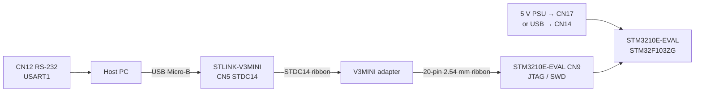

# STM3210E-EVAL

## Hardware

| Item | Value |
|------|-------|
| Board | STMicroelectronics STM3210E-EVAL (MB672) |
| MCU (current) | **STM32F103ZGT6** |
| MCU (older revs) | STM32F103ZET6 (MB672 ≤ D-03) |
| CPU | Arm Cortex-M3 |
| Max CPU frequency | 72 MHz |
| Flash (ZGT6) | 1024 KiB (dual bank, 2 KiB erase) |
| SRAM (ZGT6) | 96 KiB |
| Flash (ZET6) | 512 KiB |
| SRAM (ZET6) | 64 KiB |
| HSE | 8 MHz crystal |

Sources: ST UM0455, product page, ST BSP `stm3210e_eval.h`.

## Upstream Zephyr support

**Upstream Zephyr does not provide `stm3210e_eval`.**

Nearby upstream boards:

| Board | SoC | Notes |
|-------|-----|-------|
| `stm3210c_eval` | STM32F107VC | Different MCU (connectivity line + Ethernet) |
| `nucleo_f103rb` | STM32F103RB | Same series, different package/board |
| `waveshare/open103z` | STM32F103ZE | Similar Z package LED pins |

ZPlatform therefore ships **out-of-tree** board support under
`boards/st/stm3210e_eval/`, reusing:

- `st/f1/stm32f103Xg.dtsi` (1 MiB / 96 KiB)
- `st/f1/stm32f103z(f-g)tx-pinctrl.dtsi`
- `SOC_STM32F103XE` Kconfig
- OpenOCD / CubeProgrammer / J-Link runners via Zephyr board.cmake helpers

## Peripherals described in DeviceTree

| Function | Wiring | Notes |
|----------|--------|-------|
| Console UART | USART1 PA9/PA10 | RS-232 on CN12 |
| LEDs LD1–LD4 | PF6–PF9 | Active high |
| User Key | PG8 | `sw0` |
| Tamper | PC13 | |
| Wakeup | PA0 | Shares EXTI0 |
| I2C1 | PB6/PB7 | STLM75 @ 0x48 |
| SPI1 | PA5/PA6/PA7, CS PB2 | SPI NOR footprint |
| USB FS | PA11/PA12 | Device |
| ADC1 | PA1 (IN1) | |
| PWM | TIM1_CH1 PA8 | |
| RTC | LSI | |
| IWDG | on-chip | |
| Ethernet | — | **Not present** on STM32F103 |

FSMC memories (NOR/NAND/SRAM), LCD, audio codec, CAN, SDIO, and joystick
are present on the PCB but not all are enabled in the initial DT. Add them
incrementally with verified pinmux.

## Hardware connection (STLINK-V3MINI)

STM3210E-EVAL has **no onboard ST-Link**. Use an external probe. With
**STLINK-V3MINI** + **V3MINI adapter** (STDC14 → 20-pin 2.54 mm), the intended
path is **CN9** (ARM 20-pin JTAG/SWD). Do **not** plug the 2.54 mm ribbon into
**CN7** (1.27 mm CoreSight / Trace).

Sources: ST UM0455 (MB672), ST UM2502 (STLINK-V3MINI).

### Lab stack

```text
PC (USB)
  │  Micro-USB
  ▼
STLINK-V3MINI ──STDC14 flat cable──► V3MINI adapter ──20-pin 2.54 mm──► CN9
                                                                          │
5 V supply (CN17 jack or USB CN14) ───────────────────────────────────────┘
                                                                          │
Optional console: RS-232 CN12 (USART1) or ST-Link VCP (STDC14 13/14)
```



### What each connector is

| Connector | Pitch | Role | Use with V3MINI + adapter? |
|-----------|-------|------|----------------------------|
| **CN9** | 2.54 mm / 0.1" | Standard ARM 20-pin JTAG/SWD | **Yes — primary** |
| **CN7** | 1.27 mm CoreSight | SWD + ETM Trace | Only with a matching 1.27 mm cable (not the Waveshare 20-pin ribbon) |
| **CN12** | DB9 | USART1 RS-232 console | Serial terminal (optional) |
| **CN17** | barrel | 5 V power jack | Preferred board power |
| **CN14** | USB-B | USB FS + optional 5 V power | Alternate power / USB device |

**STLINK-V3MINI does not power the target.** Power the EVAL board first; `T_VCC`
on the probe is a **sense input** only (3.0–3.6 V).

### Recommended wiring (adapter → CN9)

Plug the 20-pin ribbon **pin-1 to pin-1** (check the red stripe / triangle). CN9
matches the usual ARM 20-pin SWD mapping used by the adapter:

| Signal | MCU pin | CN9 pin | STDC14 (V3MINI CN5) | Notes |
|--------|---------|---------|---------------------|-------|
| VTref / 3V3 | — | **1** (also 2) | **3** `T_VCC` | Sense only; board must be powered |
| SWDIO / TMS | PA13 | **7** | **4** | Required |
| GND | — | **4, 6, 8, 10…** | **5, 7** | Required |
| SWCLK / TCK | PA14 | **9** | **6** | Required |
| SWO / TDO | PB3 | **13** | **8** | Optional (ITM / SWV) |
| TDI | PA15 | **5** | **10** | Needed for full JTAG; NC for SWD |
| nTRST | PB4 | **3** | — | Not NRST; leave unused for SWD |
| **NRST** | NRST | **15** | **12** `T_NRST` | Strongly recommended |
| VCP RX (probe → MCU TX) | — | — | **13** | Optional UART bridge |
| VCP TX (MCU → probe) | — | — | **14** | Optional UART bridge |

OpenOCD in this repo uses **SWD** (`hla_swd`), so the minimum set is:
**VTref + GND + SWDIO + SWCLK + NRST**.

#### CN9 pin map (UM0455 Table 22)

```text
 Odd (top, pin 1 left)     Even (bottom)
  1  3V3     2  3V3
  3  PB4     4  GND      ← nTRST (JTAG)
  5  PA15    6  GND      ← TDI
  7  PA13    8  GND      ← TMS / SWDIO ★
  9  PA14   10  GND      ← TCK / SWCLK ★
 11  RTCK   12  GND
 13  PB3    14  GND      ← TDO / SWO
 15  RESET# 16  GND      ← NRST ★
 17  DBGRQ  18  GND
 19  DBGACK 20  GND
```

#### CN7 (reference only — CoreSight / Trace)

```text
  1  3V3     2  TMS/PA13
  3  GND     4  TCK/PA14
  5  GND     6  TDO/PB3
  7  KEY     8  TDI/PA15
  9  GND    10  RESET#
 11–20       Trace / GND (ETM)
```

### Board power and jumpers before flash

1. **BOOT0 = 0**, **BOOT1 = 0** — boot from user Flash (default).
2. **JP20 not fitted** — fitted JP20 disables JTAG/SWD.
3. **JP19** — leave open unless you intentionally tie JTAG TRST to system reset.
4. Power: **JP13** on PSU (default) → plug **5 V into CN17**, or select USB and use CN14.
5. Confirm **LD5** is on (board powered).
6. Connect STLINK-V3MINI USB to the PC; then attach the CN9 ribbon.

### Console

Default Zephyr console is **USART1** @ **115200 8N1** on **PA9 (TX) / PA10 (RX)**.

| Path | Use when |
|------|----------|
| **CN12** RS-232 | You have a DB9 null-modem / USB-RS232 cable |
| **ST-Link VCP → CN10** | No RS-232; use STLINK-V3MINI UART (recommended for this lab) |

#### ST-Link VCP → CN10 (3.3 V, no RS-232)

Keep the **CN9** SWD ribbon plugged (provides `T_VCC` sense — VCP often stays silent without it). Add three wires from the adapter’s VCP / squid pins:

| STDC14 / adapter | Direction (ST naming) | EVAL | MCU |
|------------------|----------------------|------|-----|
| **14** `T_VCP_TX` | ST-Link **input** ← | **CN10 pin 7** | **PA9** USART1_TX |
| **13** `T_VCP_RX` | ST-Link **output** → | **CN10 pin 8** | **PA10** USART1_RX |
| **5 or 7** GND | common | **CN10 pin 1 or 10** | GND |

```text
STLINK-V3MINI STDC14          STM3210E-EVAL CN10
─────────────────────         ──────────────────
pin 14  T_VCP_TX  (in)  <──── CN10.7  PA9  TX
pin 13  T_VCP_RX  (out) ────> CN10.8  PA10 RX
pin 5/7 GND          ─────── CN10.1 / CN10.10
```

**Important**

- These are **3.3 V UART** levels. Do **not** wire ST-Link to **CN12** (RS-232 ± levels).
- Labels `T_VCP_TX` / `T_VCP_RX` are from the **target** side: MCU TX → pin 14, MCU RX ← pin 13. Swapping them is the usual failure mode.
- UM0455: to take **PA10** on CN10, **remove R36** so the on-board RS-232 transceiver (U7) does not fight the ST-Link driver. PA9 (CN10.7) has no such disconnect listed.
- On the PC, open the ST-Link **Virtual COM Port** @ 115200 8N1 (Device Manager → Ports).

Optional: if VCP still shows no traffic with SWD connected, confirm CN9 pin 1 (3V3 / `T_VCC`) is making contact.
### Flash / debug after cabling

Default runner: **STM32CubeProgrammer** (flash). OpenOCD remains the debug runner.

```bash
./scripts/sh/build.sh sample board_bringup --board stm3210e_eval
./scripts/sh/flash.sh
./scripts/sh/debug.sh
```

Windows:

```powershell
.\scripts\ps1\build.ps1 sample board_bringup
.\scripts\ps1\flash.ps1
.\scripts\ps1\debug.ps1
```

Override flasher if needed: `.\scripts\ps1\flash.ps1 -Runner openocd`

#### JTAG vs SWD on CN9

CN9 carries full JTAG. Both protocols work with STLINK-V3MINI + adapter:

| Tool | SWD | JTAG |
|------|-----|------|
| STM32CubeProgrammer | `port=SWD` (default flash) | `port=JTAG` |
| OpenOCD | `support/openocd-swd.cfg` (`hla_swd`) | `support/openocd-jtag.cfg` (`hla_jtag`) |

```powershell
# CubeProgrammer JTAG flash (CLI)
STM32_Programmer_CLI -c port=JTAG mode=UR freq=4000 -w build\stm3210e_eval\board_bringup\default\zephyr\zephyr.hex -v -rst -run 0x08000000

# OpenOCD JTAG
west flash -r openocd --config boards/st/stm3210e_eval/support/openocd-jtag.cfg
```
## Build

```bash
./scripts/sh/build.sh sample board_bringup --board stm3210e_eval
./scripts/sh/build.sh demo --board stm3210e_eval
```

Artifacts: `build/stm3210e_eval/<app>/<cfg>/zephyr/zephyr.{elf,bin,hex,map}`

## MCUboot memory layout (ZGT6, 1024 KiB)

Erase size: **2 KiB**.

| Region | Offset | Size | Purpose |
|--------|--------|------|---------|
| MCUboot | `0x00000` | 64 KiB | Bootloader |
| Slot 0 | `0x10000` | 464 KiB | Primary image |
| Slot 1 | `0x84000` | 464 KiB | Update image |
| Storage | `0xF8000` | 32 KiB | Settings / NVS |

Absolute Flash base: `0x08000000`.

Swap mode: `CONFIG_BOOT_SWAP_USING_MOVE=y` (no scratch partition).

See `support/mcuboot.conf`, `stm3210e_eval_mcuboot.overlay`, and
`./scripts/sh/mcuboot_demo.sh`.

## Profiling

```bash
./scripts/sh/profile.sh demo --board stm3210e_eval
```

Uses DWT CYCCNT (Cortex-M3), thread runtime stats, and stack watermarks.
SystemView is optional and not enabled by default.

## Ztest

```bash
./scripts/sh/test.sh
./scripts/sh/test.sh platform/smoke
```

Default script mode is **build-only** for `stm3210e_eval` (no claim of
hardware pass). Use Twister device testing when hardware is attached.

## Known limitations

- Older MB672 boards with ZET6 (DEV_ID `0x414`, 512 KiB) would need a DT/memory variant — this lab board is ZGT6.
- External memories / LCD / audio / CAN / SDIO not enabled initially.
- Ethernet unavailable on this MCU.
- Hardware bring-up: STLINK-V3MINI (+ adapter) on **CN9**, board powered separately.

## Hardware validation

```text
Hardware validation: PASS console (2026-09-19)
Probe             : STLINK-V3MINI + adapter on CN9
Power             : CN14 USB
Die / ID          : STM32F103ZGT6 / DEV_ID 0x430 / 1 MiB
SWD flash         : PASS (CubeProgrammer)
JTAG connect/flash: PASS (earlier this session)
COM3 VCP          : PASS after TX/RX swap on CN10
                  : captured board_bringup banner @ 115200
                  : [PASS] LED, BUTTON, Console
```

Correct VCP wiring (confirmed on hardware):

| ST-Link | CN10 | MCU |
|---------|------|-----|
| `T_VCP_TX` (pin 14) | pin 7 | PA9 TX |
| `T_VCP_RX` (pin 13) | pin 8 | PA10 RX |
| GND | pin 1/10 | GND |

(Labels are target-side: MCU TX → pin 14, MCU RX ← pin 13.)

