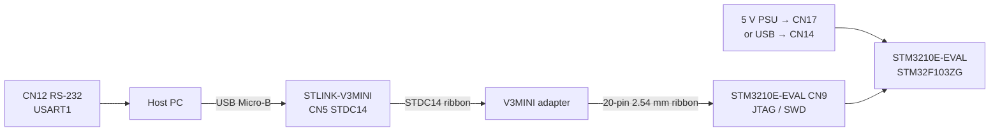

# STM3210E-EVAL

## Hardware

| Item | Value |
|------|-------|
| Board | STMicroelectronics STM3210E-EVAL (MB672) |
| MCU (current) | **STM32F103ZGT6** |
| MCU (older revs) | STM32F103ZET6 (MB672 ≤ D-03) |
| CPU | Arm Cortex-M3 |
| Max CPU frequency | 72 MHz |
| Flash (ZGT6) | 1024 KiB (dual bank, 2 KiB erase) |
| SRAM (ZGT6) | 96 KiB |
| Flash (ZET6) | 512 KiB |
| SRAM (ZET6) | 64 KiB |
| HSE | 8 MHz crystal |

Sources: ST UM0455, product page, ST BSP `stm3210e_eval.h`.

## Upstream Zephyr support

**Upstream Zephyr does not provide `stm3210e_eval`.**

Nearby upstream boards:

| Board | SoC | Notes |
|-------|-----|-------|
| `stm3210c_eval` | STM32F107VC | Different MCU (connectivity line + Ethernet) |
| `nucleo_f103rb` | STM32F103RB | Same series, different package/board |
| `waveshare/open103z` | STM32F103ZE | Similar Z package LED pins |

ZPlatform therefore ships **out-of-tree** board support under
`boards/st/stm3210e_eval/`, reusing:

- `st/f1/stm32f103Xg.dtsi` (1 MiB / 96 KiB)
- `st/f1/stm32f103z(f-g)tx-pinctrl.dtsi`
- `SOC_STM32F103XE` Kconfig
- OpenOCD / CubeProgrammer / J-Link runners via Zephyr board.cmake helpers

## EVK peripherals inventory (samples preparation)

What is **on the STM3210E-EVAL (MB672)** hardware, with part numbers where the
manual / schematic / Cube BSP name them, and how Zephyr covers that class of
device today. Use this when planning shared samples — not a project status list.

**Sources:** [UM0455](https://www.st.com/resource/en/user_manual/cd00178166.pdf),
MB672-F103ZGT6 schematic (Rev D-06), MB895 LCD module schematic,
[stm3210e-eval-bsp](https://github.com/STMicroelectronics/stm3210e-eval-bsp)
(+ components `stlm75`, `ak4343`, `hx8347d`, `ili9320`, `spfd5408`),
[product page](https://www.st.com/en/evaluation-tools/stm3210e-eval.html).

**MCU:** STM32F103**ZG**T6 (1 MiB / 96 KiB) on current boards; MB672 ≤ D-03 may
ship STM32F103**ZE**T6 (512 KiB / 64 KiB). Package TQFP-144.

### MCU, power, debug

| Feature | Part / interface | Description | Zephyr support |
|---------|------------------|-------------|----------------|
| Application MCU | STM32F103ZGT6 (or ZET6) | Cortex-M3 @ 72 MHz, FSMC, USB FS, CAN, SDIO, I2S, … | Full STM32F1 SoC support (`soc/st/stm32`, F1 series) |
| HSE | 8 MHz crystal | Main clock source for PLL → 72 MHz | Clock DT (`clk_hse` / `pll` / `rcc`) |
| Power | 5 V via CN17 jack, CN14 USB, or daughterboard; LD5 = power OK | Board-level supply (probe does not power target) | N/A (hardware) |
| VBAT / RTC backup | **CR1220** coin cell + JP1 | Keeps RTC when main power off | `rtc` on STM32; battery is board wiring |
| JTAG / SWD | CN9 ARM 20-pin (primary); CN7 CoreSight SWD+Trace | No on-board ST-Link — external probe | Runners: CubeProgrammer, OpenOCD, J-Link |
| Boot mode | BOOT0 / BOOT1 switches | User Flash / SRAM / system memory | N/A (hardware) |

### Human interface

| Feature | Part / interface | Description | Zephyr support |
|---------|------------------|-------------|----------------|
| User LEDs | LD1–LD4 on **PF6–PF9** (active high) | Four colour LEDs. Sample `gpio` (EVK): LD1 heartbeat, LD2 cpu, LD3 timer, LD4 panic (rotatable) | `gpio-leds` + `ZPLATFORM_LED_TRIGGERS` |
| Power LED | LD5 | Lit when board powered | N/A (hardware indicator) |
| User Key | B4 on **PG8** | General-purpose button; sample: pause/resume LED patterns | `gpio-keys` / input |
| Tamper | B3 on **PC13** | Tamper button; sample: enter STANDBY | `gpio-keys` / input |
| Wakeup | B2 on **PA0** | WKUP pin; mux with USART2 CTS (**JP4 open**); sample: wake from STANDBY = full reset/boot | `gpio-keys` / input |
| Reset | NRST | System reset | Hardware / probe NRST |
| Joystick | U19 — select **PG7**, up **PG15**, down **PD3**, left **PG14**, right **PG13** | 4-direction + select; sample: U/D timer, L/R rotate triggers | `gpio-keys` |

### Serial, USB, CAN, IrDA

| Feature | Part / interface | Description | Zephyr support |
|---------|------------------|-------------|----------------|
| USART1 + RS-232 | **U7** **ST3232ECTR** → **CN12** DB9; MCU **PA9/PA10** | Primary console UART @ 115200 typical | `uart` / console / shell |
| USART2 + RS-232 | **U5** **ST3232ECTR** → **CN8** DB9; TX/RX/RTS/CTS on PA2/PA3/PA1/PA0; JP4 | Second async channel with handshake | `uart` (STM32 USART2) |
| USB FS device | MCU USB on **PA11/PA12** → **CN14** Type-B | USB 2.0 full-speed device | `usb_dc_stm32` + class stacks (CDC, MSC, …) |
| CAN | **SN65HVD230** → **CN4** DB9; RX/TX **PB8/PB9**; JP6/JP8 | CAN 2.0A/B, 3.3 V PHY (standby / high-speed / slope) | `can_stm32` (bxCAN) + DT `can-transceiver` |
| IrDA | **TFDU4301-TR3** (U13; UM family TFDU4300) on **USART3** PC10/PC11; JP21/JP22 | SIR IrDA; RX mux with microSD D3 | `uart` IrDA mode (PHY transparent) |

### Sensors and analog

| Feature | Part / interface | Description | Zephyr support |
|---------|------------------|-------------|----------------|
| Board temperature | **STLM75M2F** (U9) on I2C1 **PB6/PB7**, addr **0x48**; OS/INT **PB5** (JP11) | −55 °C … +125 °C, SMBus/I2C | `lm75` (`compatible = "lm75"`) |
| Potentiometer | **RV1** → **PC4** (ADC) | Analog user control | `adc` (STM32 ADC) |
| Analog BNC inputs | **CN2/CN3/CN5** → **PC3/PC2/PC1**; 50 Ω JP23–25; LPF footprints | External analog inputs | `adc` |
| On-die temperature | STM32 internal sensor | Package temperature via ADC | `st,stm32-temp` |
| DAC | MCU DAC1/DAC2 (also wired toward audio path) | On-chip DACs | `dac` (STM32) |

### Storage

| Feature | Part / interface | Description | Zephyr support |
|---------|------------------|-------------|----------------|
| SPI serial Flash | **M25P64-VME6G** (U6); UM allows 64 **or** 128 Mbit; CS **PB2**, SPI1 PA5/PA6/PA7; JP3 MISO mux | JEDEC SPI NOR | `jedec,spi-nor` + STM32 SPI |
| FSMC SRAM | **IS61WV51216BLL-10MLI** — 512K×16; FSMC bank1 NOR/PSRAM3 | External async SRAM | OOT `ZPLATFORM_FSMC_SRAM` + `ext_sram` DT @ 0x68000000 |
| FSMC NOR Flash | U2 one of: **M29W128GL70ZA6E**, **M29W128GH70ZA6E**, **S29GL128P90FFIR20** (128 Mbit); JP5 WP | Parallel NOR, FSMC bank1 NOR/PSRAM2 — **read U2 marking** | `memc_stm32` + flash/MTD (board DT) |
| FSMC NAND Flash | **NAND512W3A2CN6E** / **NAND512W3A2BN6E** (schematic); UM 512 Mbit×8 **or** 1 Gbit×8; FSMC bank2; JP7 R/B | Parallel NAND | STM32 FMC/FSMC NAND + Zephyr NAND/MTD (board DT) |
| microSD | SDIO → **CN13**; detect **PF11**; UM cites 128 Mbyte (or larger); JP17 fitted, JP20/JP22 open | SD memory card | OOT `ZPLATFORM_SDIO_SD` (HAL_SD 1-bit bring-up) |

### Display and audio

| Feature | Part / interface | Description | Zephyr support |
|---------|------------------|-------------|----------------|
| TFT colour LCD | **MB895** on **CN16**, 320×240 (Cube landscape / HX8347D MAC 0xE0), FSMC bank1 NOR/PSRAM4 | ST BSP variants include **HX8347D**, **ILI9320**, or **SPFD5408** (runtime ID); the driver also handles **ILI9325** | OOT `zplatform,mb895-lcd` Zephyr `display` driver |
| Optional graphic LCD | **U18** footprint **HXM122032-GB1** 122×32 (default **not fitted**) | Second LCD option | N/A unless populated |
| Audio DAC + jack | **AK4343** on I2S (+ MCU DAC); PDN **PG11**; **CN15** 3.5 mm; JP15/JP18 | Stereo audio out | `i2s_stm32` data path; no in-tree `ak4343` codec (ST BSP `stm32-ak4343`) |

### Smartcard, motor control, expansion

| Feature | Part / interface | Description | Zephyr support |
|---------|------------------|-------------|----------------|
| Smartcard | **ST8024CDR** + **CN18**; async 3 V / 5 V; mux JP15/JP16 | ISO7816-class interface | No ST8024 driver; UART ISO7816 + GPIOs possible |
| Motor-control connector | **CN1** inductor-motor header | BLDC/PMSM drive signals; mux with SD / I2S / smartcard / JTAG | PWM/ADC/GPIO + external inverter |
| Extension headers | **CN10** / **CN11** PIO + FSMC | Daughterboard / wrap | DT / pinctrl |

### Multiplexing note

Several features share MCU pins (microSD ↔ IrDA ↔ motor-control ↔ smartcard ↔
I2S_MCK ↔ JTAG). UM0455 jumper tables (JP3, JP4, JP15–JP22, …) define which
function is live. Sample DT must document the jumper set it assumes.

## Samples preparation checklist

Track implementation against the inventory above. **Done** = the feature is
described in the board DTS and used by a sample and/or `demo/stm3210e_eval`;
this status alone does not claim that every sample was run on hardware.
**Partial** = DT (or bus) only, or smoke/ready-check only. **Todo** = on the
EVK, not in DTS / no sample yet. Dated physical test results are listed
separately under [Hardware validation](#hardware-validation).

| # | Feature | DT | Sample / demo | Status |
|---|---------|----|---------------|--------|
| 1 | SWD / JTAG (CN9) | runners | flash/debug scripts | **Done** |
| 2 | USART1 console (CN12) | `usart1` | `board_bringup`, demo, shell | **Done** |
| 3 | LEDs LD1–LD4 | `gpio-leds` | `samples/gpio` triggers (HB/CPU/TIM/PAN); rotatable | **Done** |
| 4 | User Key (B4) | `sw0` | `samples/gpio` pause/resume | **Done** |
| 5 | Tamper (B3) | `sw1` | `samples/gpio` → STANDBY | **Done** |
| 6 | Wakeup (B2) | `sw-wakeup` | `samples/gpio` WKUP → reset/boot | **Done** |
| 7 | Joystick (U19) | joy-* aliases | `samples/gpio` timer + rotate | **Done** |
| 8 | STLM75M2F temp | `stlm75` / `lm75` | `sensor`, demo | **Done** |
| 9 | Die temperature | `die_temp` | demo live | **Done** |
| 10 | SPI1 bus | `spi1` + CS PB2 | demo bus-ready | **Done** |
| 11 | SPI NOR M25P64 | `m25p64` / `jedec,spi-nor` | `samples/spi_flash`, demo JEDEC | **Done** |
| 12 | ADC1 | `adc1` + IN11–14 | `samples/adc` (RV1), BNC DT | **Done** |
| 13 | RV1 potentiometer (PC4) | `adc1_in14_pc4` / `zephyr,user` | `samples/adc`, demo | **Done** |
| 14 | BNC analog (PC1–PC3) | ADC IN11–13 in DT | DT ready (probe via adc) | **Partial** |
| 15 | PWM TIM1_CH1 (PA8) | `pwm1` + `pwm-led0` | `samples/pwm`, demo set | **Done** |
| 16 | RTC (+ CR1220) | `rtc` (F1 counter; DTS selects LSI) | Tick reads; battery-backed retention is not verified | **Done** |
| 17 | IWDG | `iwdg` | DT / alias | **Partial** |
| 18 | USB FS (CN14) | `usb` okay | `samples/usb_cdc` (CAN off) | **Done** |
| 19 | USART2 (CN8) | node disabled | — | **Todo** (JP4 mux) |
| 20 | IrDA TFDU4301 (USART3) | — | — | **Todo** (mux SD) |
| 21 | CAN SN65HVD230 (CN4) | `can1` + overlay | `samples/can` loopback, demo | **Done** |
| 22 | FSMC SRAM | `ext_sram` @ 0x68000000 | `samples/ext_sram` | **Done** |
| 23 | FSMC NOR Flash | — | — | **Todo** |
| 24 | FSMC NAND Flash | — | — | **Todo** (no driver yet) |
| 25 | microSD (CN13) | SDIO + `ZPLATFORM_SDIO_SD` | `samples/microsd` | **Done** |
| 26 | TFT LCD MB895 (CN16) | `zephyr,display` + `mb895-lcd` | `samples/lcd` display API | **Done** |
| 27 | Audio AK4343 (CN15) | — | — | **Todo** (no codec driver) |
| 28 | Smartcard ST8024 (CN18) | — | — | **Todo** |
| 29 | DAC channels | `dac1` + `zephyr,user` | `samples/dac` (PA4 CH1), demo | **Done** |
| 30 | Motor-control (CN1) | — | — | **Todo** |
| 31 | Extension CN10/CN11 | as needed | — | **Todo** |

### Repo samples (status)

| App | Purpose | Status |
|-----|---------|--------|
| `samples/board_bringup` | LED + button + console smoke | **Done** |
| `samples/gpio` | EVK: LED triggers + sleep/wake/joystick; else led0/sw0 | **Done** |
| `samples/sensor` | STLM75 ambient temp | **Done** |
| `samples/spi_flash` | M25P64 JEDEC ID + read (JP3) | **Done** |
| `samples/adc` | RV1 pot on ADC1_IN14 (PC4) | **Done** |
| `samples/pwm` | TIM1_CH1 PA8 duty (CN10 / scope) | **Done** |
| `samples/lcd` | MB895 via Zephyr `display` API (CN16) | **Done** |
| `samples/ext_sram` | FSMC bank3 IS61WV51216 selftest | **Done** |
| `samples/microsd` | SDIO CN13 detect + R/W | **Done** |
| `samples/lvgl` | Brand splash on MB895 (VDB in EXT_SRAM) | **Done** |
| `samples/rtc` | RTC counter start and tick reads (DTS-selected LSI) | **Done** |
| `samples/dac` | DAC1 CH1 PA4 sawtooth | **Done** |
| `samples/can` | bxCAN loopback (USB off — IRQ share) | **Done** |
| `samples/usb_cdc` | USB FS CDC ACM on CN14 | **Done** |
| `demo/stm3210e_eval` | Console smoke + LVGL UI (live peri/threads) | **Done** |
| `tests/platform/smoke` | Ztest smoke | **Done** (on-device) |
| `tests/drivers/display` | MB895 `display` API (write/blanking/ID) | **Implemented**; no dated run is recorded below |

### Suggested next (planning)

1. FatFS / Zephyr `disk` on SDIO once product needs filesystem.
2. FSMC NOR / **NAND512W3A** (not supported yet — Todo).
3. Audio AK4343 / Smartcard / IrDA when product demos need them (jumper mux).
4. IWDG deeper sample; USART2 with JP4.
5. Touch / richer LVGL widgets on the EVK UI.

## Hardware connection (STLINK-V3MINI)

STM3210E-EVAL has **no onboard ST-Link**. Use an external probe. With
**STLINK-V3MINI** + **V3MINI adapter** (STDC14 → 20-pin 2.54 mm), the intended
path is **CN9** (ARM 20-pin JTAG/SWD). Do **not** plug the 2.54 mm ribbon into
**CN7** (1.27 mm CoreSight / Trace).

Sources: ST UM0455 (MB672), ST UM2502 (STLINK-V3MINI).

### Lab stack

```text
PC (USB)
  │  Micro-USB
  ▼
STLINK-V3MINI ──STDC14 flat cable──► V3MINI adapter ──20-pin 2.54 mm──► CN9
                                                                          │
5 V supply (CN17 jack or USB CN14) ───────────────────────────────────────┘
                                                                          │
Optional console: RS-232 CN12 (USART1) or ST-Link VCP (STDC14 13/14)
```



### What each connector is

| Connector | Pitch | Role | Use with V3MINI + adapter? |
|-----------|-------|------|----------------------------|
| **CN9** | 2.54 mm / 0.1" | Standard ARM 20-pin JTAG/SWD | **Yes — primary** |
| **CN7** | 1.27 mm CoreSight | SWD + ETM Trace | Only with a matching 1.27 mm cable (not the Waveshare 20-pin ribbon) |
| **CN12** | DB9 | USART1 RS-232 console | Serial terminal (optional) |
| **CN17** | barrel | 5 V power jack | Preferred board power |
| **CN14** | USB-B | USB FS + optional 5 V power | Alternate power / USB device |

**STLINK-V3MINI does not power the target.** Power the EVAL board first; `T_VCC`
on the probe is a **sense input** only (3.0–3.6 V).

### Recommended wiring (adapter → CN9)

Plug the 20-pin ribbon **pin-1 to pin-1** (check the red stripe / triangle). CN9
matches the usual ARM 20-pin SWD mapping used by the adapter:

| Signal | MCU pin | CN9 pin | STDC14 (V3MINI CN5) | Notes |
|--------|---------|---------|---------------------|-------|
| VTref / 3V3 | — | **1** (also 2) | **3** `T_VCC` | Sense only; board must be powered |
| SWDIO / TMS | PA13 | **7** | **4** | Required |
| GND | — | **4, 6, 8, 10…** | **5, 7** | Required |
| SWCLK / TCK | PA14 | **9** | **6** | Required |
| SWO / TDO | PB3 | **13** | **8** | Optional (ITM / SWV) |
| TDI | PA15 | **5** | **10** | Needed for full JTAG; NC for SWD |
| nTRST | PB4 | **3** | — | Not NRST; leave unused for SWD |
| **NRST** | NRST | **15** | **12** `T_NRST` | Strongly recommended |
| VCP RX (probe → MCU TX) | — | — | **13** | Optional UART bridge |
| VCP TX (MCU → probe) | — | — | **14** | Optional UART bridge |

OpenOCD in this repo uses **SWD** (`hla_swd`), so the minimum set is:
**VTref + GND + SWDIO + SWCLK + NRST**.

#### CN9 pin map (UM0455 Table 22)

```text
 Odd (top, pin 1 left)     Even (bottom)
  1  3V3     2  3V3
  3  PB4     4  GND      ← nTRST (JTAG)
  5  PA15    6  GND      ← TDI
  7  PA13    8  GND      ← TMS / SWDIO ★
  9  PA14   10  GND      ← TCK / SWCLK ★
 11  RTCK   12  GND
 13  PB3    14  GND      ← TDO / SWO
 15  RESET# 16  GND      ← NRST ★
 17  DBGRQ  18  GND
 19  DBGACK 20  GND
```

#### CN7 (reference only — CoreSight / Trace)

```text
  1  3V3     2  TMS/PA13
  3  GND     4  TCK/PA14
  5  GND     6  TDO/PB3
  7  KEY     8  TDI/PA15
  9  GND    10  RESET#
 11–20       Trace / GND (ETM)
```

### Board power and jumpers before flash

1. **BOOT0 = 0**, **BOOT1 = 0** — boot from user Flash (default).
2. **JP20 not fitted** — fitted JP20 disables JTAG/SWD.
3. **JP19** — leave open unless you intentionally tie JTAG TRST to system reset.
4. Power: **JP13** on PSU (default) → plug **5 V into CN17**, or select USB and use CN14.
5. Confirm **LD5** is on (board powered).
6. Connect STLINK-V3MINI USB to the PC; then attach the CN9 ribbon.

### Console

Default Zephyr console is **USART1** @ **115200 8N1** on **PA9 (TX) / PA10 (RX)**.

| Path | Use when |
|------|----------|
| **CN12** RS-232 | You have a DB9 null-modem / USB-RS232 cable |
| **ST-Link VCP → CN10** | No RS-232; use STLINK-V3MINI UART (recommended for this lab) |

#### ST-Link VCP → CN10 (3.3 V, no RS-232)

Keep the **CN9** SWD ribbon plugged (provides `T_VCC` sense — VCP often stays silent without it). Add three wires from the adapter’s VCP / squid pins:

| STDC14 / adapter | Direction (ST naming) | EVAL | MCU |
|------------------|----------------------|------|-----|
| **14** `T_VCP_TX` | ST-Link **input** ← | **CN10 pin 7** | **PA9** USART1_TX |
| **13** `T_VCP_RX` | ST-Link **output** → | **CN10 pin 8** | **PA10** USART1_RX |
| **5 or 7** GND | common | **CN10 pin 1 or 10** | GND |

```text
STLINK-V3MINI STDC14          STM3210E-EVAL CN10
─────────────────────         ──────────────────
pin 14  T_VCP_TX  (in)  <──── CN10.7  PA9  TX
pin 13  T_VCP_RX  (out) ────> CN10.8  PA10 RX
pin 5/7 GND          ─────── CN10.1 / CN10.10
```

**Important**

- These are **3.3 V UART** levels. Do **not** wire ST-Link to **CN12** (RS-232 ± levels).
- Labels `T_VCP_TX` / `T_VCP_RX` are from the **target** side: MCU TX → pin 14, MCU RX ← pin 13. Swapping them is the usual failure mode.
- UM0455: to take **PA10** on CN10, **remove R36** so the on-board RS-232 transceiver (U7) does not fight the ST-Link driver. PA9 (CN10.7) has no such disconnect listed.
- On the PC, open the ST-Link **Virtual COM Port** @ 115200 8N1 (Device Manager → Ports).

Optional: if VCP still shows no traffic with SWD connected, confirm CN9 pin 1 (3V3 / `T_VCC`) is making contact.
### Flash / debug after cabling

Default runner: **STM32CubeProgrammer** (flash). OpenOCD remains the debug runner.
Commands: [`scripts/README.md`](../../scripts/README.md) (`build` / `flash` / `debug`).
Override flasher: `flash … -Runner openocd` / `--runner openocd`.

#### JTAG vs SWD on CN9

CN9 carries full JTAG. Both protocols work with STLINK-V3MINI + adapter:

| Tool | SWD | JTAG |
|------|-----|------|
| STM32CubeProgrammer | `port=SWD` (default flash) | `port=JTAG` |
| OpenOCD | `support/openocd-swd.cfg` (`hla_swd`) | `support/openocd-jtag.cfg` (`hla_jtag`) |

```powershell
# CubeProgrammer JTAG flash (CLI)
STM32_Programmer_CLI -c port=JTAG mode=UR freq=4000 -w build\stm3210e_eval\board_bringup\default\zephyr\zephyr.hex -v -rst -run 0x08000000

# OpenOCD JTAG
west flash -r openocd --config boards/st/stm3210e_eval/support/openocd-jtag.cfg
```
## Build

Commands and flag combinations: [`scripts/README.md`](../../scripts/README.md).

The demo lives at `demo/stm3210e_eval/` (selected from `-Board` / `--board`).
Board `*_defconfig` is bring-up only; SHELL / I2C / SENSOR and other showcase
options are in the demo `prj.conf`.

Artifacts (isolated per kind/config):

```text
build/stm3210e_eval/demo/default/
build/stm3210e_eval/demo/mcuboot/
build/stm3210e_eval/sample/board_bringup/default/
build/stm3210e_eval/sample/gpio/default/
build/stm3210e_eval/sample/sensor/default/
```

Flash/debug never rebuild; pass `-Config` / `--config` to pick a tree.

**default vs `-Mcuboot`:** standalone builds use a single DTS `code_partition`
(whole 1 MiB) as `zephyr,code-partition`. `-Mcuboot` applies
`support/partitions_mcuboot.dtsi` (replaces that node with boot/slot0/slot1/storage)
plus `stm3210e_eval_mcuboot.overlay` so the app links into slot0. After every
build, `--print-layout` shows the active map and marks `<- THIS IMAGE`.

## MCUboot memory layout (ZGT6, 1024 KiB)

Erase size: **2 KiB**.

| Region | Offset | Size | Bank | Purpose |
|--------|--------|------|------|---------|
| MCUboot | `0x00000` | 64 KiB | 1 | Bootloader |
| Slot 1 | `0x10000` | 448 KiB | 1 | Update image (secondary) |
| Slot 0 | `0x80000` | 448 KiB | 2 | Primary image (runs here) |
| Storage | `0xF0000` | 64 KiB | 2 | Settings / NVS |

Absolute Flash base: `0x08000000`. Primary is in **bank 2** so MCUboot
(executing in bank 1) can erase/program it without hanging the CPU
(STM32F1 cannot fetch code from a bank that is being programmed).

Upgrade mode: `CONFIG_BOOT_UPGRADE_ONLY=y` (overwrite slot1 → slot0).

Signature: **ECDSA-P256** + TinyCrypt (RSA/mbedTLS does not fit the
64 KiB boot slot). Development key: `keys/root-ec-p256.pem` (not
committed; see `keys/README.md`).

Flash addresses (CubeProgrammer):

| Image | Address |
|-------|---------|
| MCUboot | `0x08000000` |
| Signed slot 0 (primary) | `0x08080000` |
| Signed slot 1 (upgrade) | `0x08010000` |

```powershell
# Build/sign (+ optional flash and slot1 upgrade) — see scripts/README.md
.\scripts\ps1\mcuboot_demo.ps1 -Flash -Upgrade
```

Scripts pass `-DZPLATFORM_ROOT=<repo>` so the ECDSA key path in
`support/mcuboot.conf` stays portable. See `stm3210e_eval_mcuboot.overlay`.

## Profiling / Ztest

Use `profile` / `test` from [`scripts/README.md`](../../scripts/README.md).
Profiling uses DWT CYCCNT, thread runtime stats, and stack watermarks.
Twister default mode is **build-only** for this board.

## Known limitations

- Older MB672 boards with ZET6 (DEV_ID `0x414`, 512 KiB) need a DT/memory variant — this lab board is ZGT6.
- NOR Flash U2 and NAND density/controller marking can vary by build; identify the part on the PCB before writing flash samples.
- Many connectors share pins — see **Multiplexing note** in the EVK inventory.
- The current MCUboot configuration selects `CONFIG_BOOT_UPGRADE_ONLY`.
  The dated swap-move upgrade result below is from a different configuration
  and does not verify the current overwrite-only `mcuboot_demo -Upgrade` flow.
  Treat the current upgrade flow as unverified until it is rerun on this
  configuration.
- Progress on DT/samples: **Samples preparation checklist**.
- Hardware bring-up: STLINK-V3MINI (+ adapter) on **CN9**, board powered separately.

## Hardware validation

The following is the recorded hardware-validation snapshot from 2026-09-19.
The MCUboot swap-move result is historical and does not correspond to the
current `CONFIG_BOOT_UPGRADE_ONLY` setting described above.

```text
Hardware validation: PASS (2026-09-19)
Probe             : STLINK-V3MINI + adapter on CN9
Power             : CN14 USB
Die / ID          : STM32F103ZGT6 / DEV_ID 0x430 / 1 MiB
SWD flash         : PASS (CubeProgrammer preferred)
JTAG connect/flash: PASS
COM3 VCP          : PASS after TX/RX swap on CN10 @ 115200
board_bringup     : PASS (LED, BUTTON, Console)
platform smoke    : PASS (3/3 ztest on-device)
demo/stm3210e_eval : PASS (peripherals + shell `zplatform info`)
MCUboot + signed  : PASS (v2.4.0 → slot0; ECDSA-P256; confirm in demo)
MCUboot upgrade   : Historical PASS with swap-move (slot1→slot0)
                  : Not a result for the current overwrite-only configuration
```

Correct VCP wiring (confirmed on hardware):

| ST-Link | CN10 | MCU |
|---------|------|-----|
| `T_VCP_TX` (pin 14) | pin 7 | PA9 TX |
| `T_VCP_RX` (pin 13) | pin 8 | PA10 RX |
| GND | pin 1/10 | GND |

(Labels are target-side: MCU TX → pin 14, MCU RX ← pin 13.)
