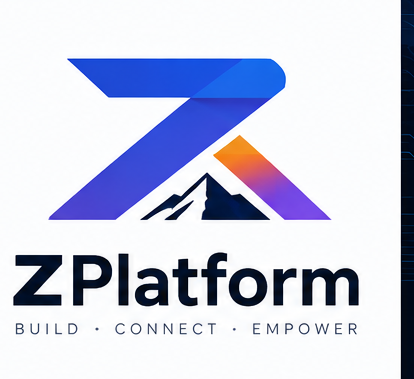

# ZPlatform brand

Reusable identity for docs, demos, and social assets.

- **Copy + colors:** [`brand.yml`](brand.yml) (source of truth)
- **Visuals:** [`assets/`](assets/) (hand-curated)
- **Firmware strings:** [`include/zplatform/brand.h`](../../include/zplatform/brand.h)

**BUILD · CONNECT · EMPOWER**  
*Embedded for a Brighter Tomorrow* · *Small Steps. Real Impact.*

> Technology is more meaningful when it empowers people.  
> — Ponmadasamy

## Colors

Use these hex values wherever brand color is needed (docs, CSS, UI mocks).
Defined in `brand.yml` — do not rely on a palette image.

| Name | Hex | Meaning |
|------|-----|---------|
| Midnight | `#0B1220` | Stability, Focus |
| Azure | `#2563EB` | Technology, Trust |
| Cyan | `#06B6D4` | Clarity, Innovation |
| Purple | `#8B5CF6` | Creativity, Modern |
| Amber | `#F59E0B` | Energy, Progress |
| Snow | `#F8FAFC` | Clean, Minimal |

## Quote

Text only (no card image) — also in `brand.yml` / `brand.h`:

> Technology is more meaningful when it empowers people.  
> — Ponmadasamy

## Assets

| File | Use |
|------|-----|
| [`logo-lockup.png`](assets/logo-lockup.png) | README / docs header |
| [`logo-mark.png`](assets/logo-mark.png) | Compact mark |
| [`icon.png`](assets/icon.png) | Primary icon |
| [`icon-on-light.png`](assets/icon-on-light.png) | App icon (light) — *placeholder: logo copy* |
| [`icon-on-dark.png`](assets/icon-on-dark.png) | App icon (dark) — *placeholder: logo copy* |
| [`icon-mono.png`](assets/icon-mono.png) | App icon (mono) — *placeholder: logo copy* |
| [`icon-social.png`](assets/icon-social.png) | Social avatar |
| [`icons-app-favicon.png`](assets/icons-app-favicon.png) | App / favicon sheet |
| [`all-icon.png`](assets/all-icon.png) | Combined icon reference |
| [`hero-banner.png`](assets/hero-banner.png) | Wide hero strip |
| [`banner-circuit.png`](assets/banner-circuit.png) | Tech / Zephyr banner |
| [`evk-lcd-demo.png`](assets/evk-lcd-demo.png) | EVK LCD UI mock |
| [`brand-board-full.png`](assets/brand-board-full.png) | Full master board (reference) |

## Copy (reuse)

| Key | Text |
|-----|------|
| Name | ZPlatform |
| Tagline | BUILD · CONNECT · EMPOWER |
| Vision | Embedded for a Brighter Tomorrow |
| Impact | Small Steps. Real Impact. |
| Positioning | Zephyr-powered embedded solutions |
| Pillars | Ideas · Hardware · Software · People · A Brighter Tomorrow |
| Capabilities | MCU Bring-up · Samples & Demos · Secure (MCUboot) · Test & Profile · Multiple Boards |

## Notes

- Quote and color palette are **data/text**, not PNGs.
- `icon-on-light` / `icon-on-dark` / `icon-mono` are temporary logo copies until tuned variants are ready.
- Prefer editing assets by hand; `_extract_board.py` is optional and must not overwrite cleaned files without care.
